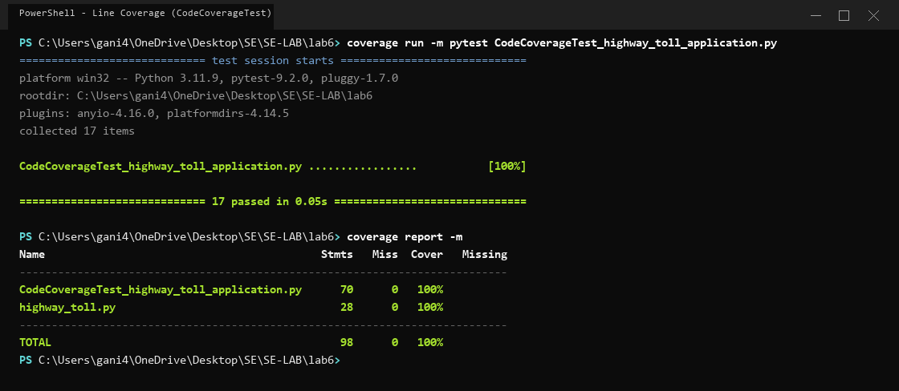
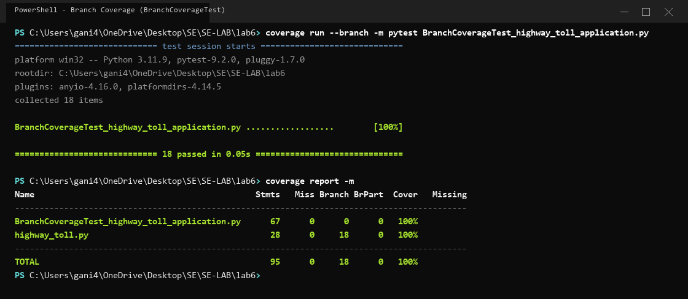

# Lab 6: Code and Branch Coverage Analysis — Highway Toll Application

## Student Details
- **Course**: Software Engineering Lab (SE-LAB)
- **Lab Assignment**: Lab 6 — Code and Branch Coverage Analysis
- **Assigned Repository**: [SETAPESU26/L6_L7_36_highway_toll](https://github.com/SETAPESU26/L6_L7_36_highway_toll)
- **Destination Repository**: [Ganesh-Aroda-C/SE-LAB](https://github.com/Ganesh-Aroda-C/SE-LAB)
- **Target Application**: `highway_toll.py`

---

## 1. Lab Objectives
- Understand the fundamental differences between line (code) coverage, branch coverage, and path coverage.
- Use `pytest` and Python's `coverage` library to measure, evaluate, and enhance test completeness.
- Identify untested statements, conditional decisions, boundary values, and exception paths in application code.
- Design comprehensive test suites that achieve at least 90% (up to 100%) line coverage and branch coverage without artificial inflation.

---

## 2. Highway Toll Application Overview (`highway_toll.py`)
The assigned application calculates toll fees on automated highway tollways based on:
1. **Axle Count**:
   - Valid count must be $\ge 2$; counts $< 2$ raise a `ValueError("invalid axle count")`.
   - 2 axles: Standard base toll = ₹100.
   - 3 axles: Standard base toll = ₹150.
   - 4 axles: Standard base toll = ₹250.
   - 5 or more axles: Default base toll = ₹400.
2. **Peak Hour Surcharges**:
   - `is_peak=True`: Adds a 25% surcharge (`base * 1.25`).
3. **FASTag Electronic Toll Collection Discounts**:
   - `has_fastag=True` on 2-axle vehicles: 10% discount (`base * 0.9`).
   - `has_fastag=True` on $>2$-axle vehicles: 5% discount (`base * 0.95`).
   - Output rounded to 2 decimal places (`round(base, 2)`).
4. **Emergency Vehicle Exemptions**:
   - Vehicles in `EXEMPT = ("ambulance", "fire_engine")` incur ₹0 charge.
5. **Monthly Pass Advisory (`pass_advice`)**:
   - Computes aggregate trip cost against monthly pass price.
   - Returns `"buy_pass"` if cost > pass price, `"either"` if cost == pass price, and `"pay_per_trip"` if cost < pass price.

---

## 3. Difference Between Code Coverage and Branch Coverage

| Metric | Definition | Practical Impact |
| :--- | :--- | :--- |
| **Line (Code) Coverage** | Measures the percentage of executable lines of code that have been traversed at least once during test execution. | Can report high or 100% coverage while completely missing alternative decision branches (e.g., an `if` statement evaluated only when `True`, never testing what happens when `False`). |
| **Branch Coverage** | Measures whether every decision branch (both `TRUE` and `FALSE` outcomes) of every control structure (`if`, `else`, loop boundary) has been exercised. | Forces the test engineer to probe alternate paths, negative cases, boundary conditions, and exception handlers, preventing untested logical branches from slipping into production. |

---

## 4. Tools Used & Installation
- **Python**: 3.11+
- **pytest**: 9.2.0 (Test framework and runner)
- **coverage**: 7.17.2 (Code and branch coverage measurement engine)

### Setup Commands
```bash
python -m pip install coverage pytest
```

---

## 5. Coverage Results Summary

| Analysis Phase | Test File Used | Tests Passed | Statements | Missed Stmts | Branches | Missed Branches | Coverage % |
| :--- | :--- | :--- | :--- | :--- | :--- | :--- | :--- |
| **Initial Baseline (Line)** | `test_highway_toll.py` | 2 | 28 | 15 | - | - | **46%** |
| **Initial Baseline (Branch)** | `test_highway_toll.py` | 2 | 28 | 15 | 18 | 5 | **39%** |
| **Final Code Coverage** | `CodeCoverageTest_highway_toll_application.py` | 17 | 98 | 0 | - | - | **100%** |
| **Final Branch Coverage** | `BranchCoverageTest_highway_toll_application.py` | 18 | 95 | 0 | 18 | 0 | **100%** |

Both targets exceed the required **90%** threshold, achieving a perfect **100%** coverage across both metrics.

---

## 6. Execution Commands

### Run Code Coverage
```bash
coverage run -m pytest CodeCoverageTest_highway_toll_application.py
coverage report -m
```

### Run Branch Coverage
```bash
coverage run --branch -m pytest BranchCoverageTest_highway_toll_application.py
coverage report -m
```

---

## 7. Terminal Screenshots

### 7.1 Code Coverage Terminal Execution (`code_coverage.png`)
Shows 17 passing tests, statement metrics, zero missing lines, and **100%** line coverage:



### 7.2 Branch Coverage Terminal Execution (`branch_coverage.png`)
Shows 18 passing tests, statement & branch metrics (18 branches, 0 missed), and **100%** branch coverage:



---

## 8. Test Suite Details

### 8.1 Code Coverage Tests (`CodeCoverageTest_highway_toll_application.py`)
1. `test_toll_for_invalid_axle_count_raises_value_error`: Validates `ValueError` for axle counts $< 2$ (1, 0, -2).
2. `test_toll_for_two_axles_standard_rate`: 2-axle base tariff ₹100.
3. `test_toll_for_three_axles_standard_rate`: 3-axle base tariff ₹150.
4. `test_toll_for_four_axles_standard_rate`: 4-axle base tariff ₹250.
5. `test_toll_for_five_or_more_axles_default_rate`: 5+ axles default tariff ₹400.
6. `test_toll_for_peak_hour_surcharges`: 25% peak hour surcharges across all axle tiers.
7. `test_toll_for_fastag_discount_two_axles`: 10% FASTag discount for 2-axle vehicles.
8. `test_toll_for_fastag_discount_multi_axles`: 5% FASTag discount for $>2$-axle vehicles.
9. `test_toll_for_combined_peak_and_fastag`: Combined peak surcharge + FASTag discount with rounding.
10. `test_toll_charge_exempt_vehicles`: Emergency vehicle exemption (ambulance, fire_engine -> ₹0).
11. `test_toll_charge_non_exempt_standard_vehicles`: Normal vehicles delegating to `toll_for`.
12. `test_toll_charge_non_exempt_invalid_axles_raises`: Non-exempt vehicles propagating `ValueError`.
13. `test_pass_advice_buy_pass`: Trip cost > pass price recommending `"buy_pass"`.
14. `test_pass_advice_either`: Trip cost == pass price recommending `"either"`.
15. `test_pass_advice_pay_per_trip`: Trip cost < pass price recommending `"pay_per_trip"`.
16. `test_pass_advice_empty_trips_list`: Empty trip schedule handling (zero cost).
17. `test_pass_advice_mixed_trips_scenario`: Multi-trip mixed peak and FASTag evaluation.

### 8.2 Branch Coverage Tests (`BranchCoverageTest_highway_toll_application.py`)
1. `test_branch_axles_less_than_two_true`: Decision `axles < 2` evaluates to **TRUE** (raises `ValueError`).
2. `test_branch_axles_less_than_two_false`: Decision `axles < 2` evaluates to **FALSE** (valid axle count $\ge 2$).
3. `test_branch_axles_in_base_toll_true`: Decision `axles in BASE_TOLL` evaluates to **TRUE** (axles 2, 3, 4).
4. `test_branch_axles_in_base_toll_false`: Decision `axles in BASE_TOLL` evaluates to **FALSE** (axles 5, 7 default to 400).
5. `test_branch_is_peak_true`: Decision `is_peak` evaluates to **TRUE** (1.25 multiplier).
6. `test_branch_is_peak_false`: Decision `is_peak` evaluates to **FALSE** (unmodified base).
7. `test_branch_has_fastag_true`: Decision `has_fastag` evaluates to **TRUE** (discount branch entered).
8. `test_branch_has_fastag_false`: Decision `has_fastag` evaluates to **FALSE** (no discount).
9. `test_branch_fastag_axles_equals_two_true`: Decision `axles == 2` in FASTag evaluates to **TRUE** (10% discount).
10. `test_branch_fastag_axles_equals_two_false`: Decision `axles == 2` in FASTag evaluates to **FALSE** (5% discount).
11. `test_branch_vehicle_in_exempt_true`: Decision `vehicle in EXEMPT` evaluates to **TRUE** (ambulance, fire_engine -> ₹0).
12. `test_branch_vehicle_not_in_exempt_false`: Decision `vehicle in EXEMPT` evaluates to **FALSE** (calls `toll_for`).
13. `test_branch_trips_loop_entered`: Loop `for trip in trips` evaluates to **TRUE** (executed for non-empty trips).
14. `test_branch_trips_loop_bypassed`: Loop `for trip in trips` evaluates to **FALSE** (bypassed for empty trips).
15. `test_branch_cost_greater_than_pass_price_true`: Decision `cost > pass_price` evaluates to **TRUE** (`"buy_pass"`).
16. `test_branch_cost_greater_than_pass_price_false`: Decision `cost > pass_price` evaluates to **FALSE** (proceeds).
17. `test_branch_cost_equals_pass_price_true`: Decision `cost == pass_price` evaluates to **TRUE** (`"either"`).
18. `test_branch_cost_equals_pass_price_false`: Decision `cost == pass_price` evaluates to **FALSE** (`"pay_per_trip"`).

---

## 9. Folder Structure

```
SE-LAB/
├── lab6/
│   ├── .gitignore
│   ├── README.md                                          # Lab 6 comprehensive documentation
│   ├── highway_toll.py                                    # Original highway toll application
│   ├── CodeCoverageTest_highway_toll_application.py       # 17 code coverage test cases (100% line coverage)
│   ├── BranchCoverageTest_highway_toll_application.py     # 18 branch coverage test cases (100% branch coverage)
│   └── screenshots/
│       ├── code_coverage.png                              # Terminal execution for line coverage
│       └── branch_coverage.png                            # Terminal execution for branch coverage
└── [Existing Lab1, Lab2, Lab3, Lab4, lab5 preserved]
```
